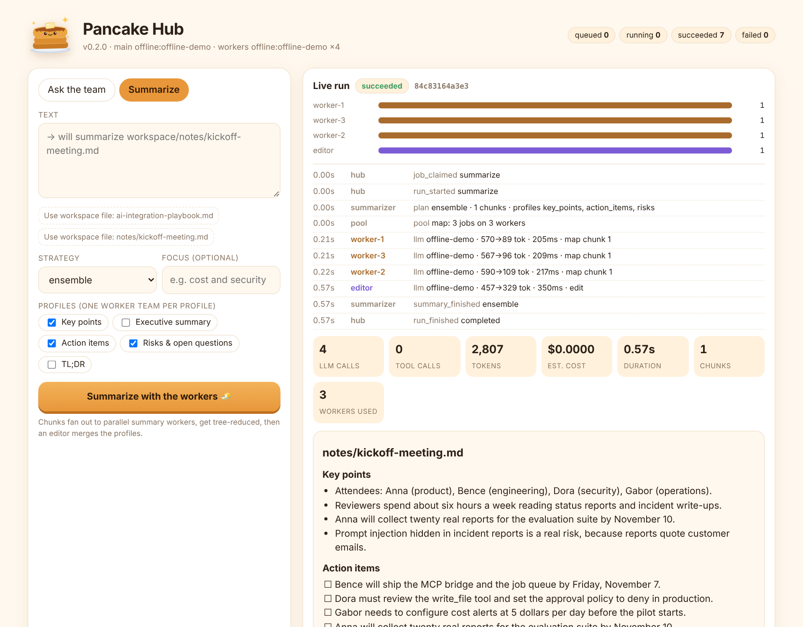
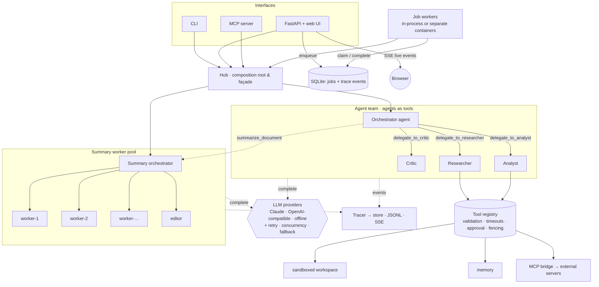
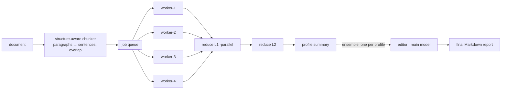

<p align="center">
  
</p>

<h1 align="center">shiny-pancake</h1>

<p align="center">
  <b>A multi-agent LLM hub: an agent team, parallel summary workers, a job queue, an eval harness and MCP in both directions.</b><br>
  <i>a stack of LLM agents, served warm</i> 🥞
</p>

<p align="center">
  <a href="https://github.com/b0mbera/shiny-pancake/actions/workflows/ci.yml"></a>
  
  
  
</p>

shiny-pancake shows how LLMs get wired into real systems: vendor-neutral providers, tools with
guardrails, multi-agent orchestration, parallel workers, durable jobs, live observability,
evaluation and the Model Context Protocol. It is a **service** (HTTP API + web UI + Docker),
a **CLI** and a **library/harness** you can plug your own models, tools and agents into.

Everything runs **offline with no API key**. A deterministic demo provider drives the real agent
loop, tool registry, worker pool and tracing, so you can clone it, run it and read the traces in
under a minute. Set `ANTHROPIC_API_KEY` to switch to Claude, or point it at any OpenAI-compatible
endpoint (Ollama, vLLM, LM Studio, OpenAI).

<p align="center"></p>

> 🇭🇺 Magyar nyelvű összefoglaló: [docs/OSSZEFOGLALO.md](docs/OSSZEFOGLALO.md)

## What this repository demonstrates

| Concern | How shiny-pancake handles it |
|---|---|
| **Vendor independence** | One `LLMProvider` interface and a canonical message format. Claude (Anthropic SDK 2.x), any OpenAI-compatible API (plain `httpx`) and an offline provider ship in the box |
| **Claude, done properly** | Prompt caching (static prefix + conversation tail), server-side refusal fallbacks, thinking blocks replayed unchanged (append-only history), `effort`, no sampling params (API 2026-10-21), typed error mapping |
| **Model routing** | Cheap fast model for parallel summary workers, main model for orchestration and the final edit |
| **Multi-agent orchestration** | Orchestrator-workers pattern; specialists are exposed **as tools**, so delegation reuses validation, timeouts, tracing and parallel tool calls |
| **Multiple summary workers** | A worker pool over an `asyncio.Queue`: map-reduce with tree reduction, refine, and an *ensemble* of perspectives merged by an editor model |
| **Tools & guardrails** | Schema validation, timeouts, output limits, approval policy for side effects, sandboxed files, untrusted-content fencing and prompt-injection signals |
| **External systems** | `MCPBridge` turns any MCP server (stdio or HTTP) into tools at runtime; `mcp-serve` exposes the hub itself as an MCP server |
| **Hub & scale-out** | Durable SQLite job queue (WAL, atomic claims, crash recovery), worker processes that scale horizontally in Docker, live progress over Server-Sent Events |
| **Resilience & cost** | Bounded concurrency, retries with jittered backoff, cross-vendor fallback, step and token budgets, per-agent/per-worker token and cost accounting |
| **Observability** | Every LLM call, tool call and pipeline step is a trace event, persisted, streamed to the UI and exported as JSONL |
| **Evaluation** | JSONL eval suites with deterministic checks (content, regex, tools used, agents used, call and cost budgets) plus an optional LLM judge; runs in CI |
| **Delivery** | CLI, FastAPI service with web UI, multi-stage non-root Docker image, docker-compose with scaled workers and optional Ollama, GitHub Actions |

## Quick start

```bash
git clone https://github.com/b0mbera/shiny-pancake.git
cd shiny-pancake
python -m venv .venv && source .venv/bin/activate
pip install -e ".[dev]"
```

Offline, no API key needed:

```bash
shiny-pancake run "What is 12 * (3 + 4)? Check it." --offline --show-trace
```

```bash
shiny-pancake summarize workspace/ai-integration-playbook.md --strategy ensemble --offline
```

```bash
shiny-pancake serve --offline        # web UI on http://127.0.0.1:8000, API docs on /docs
```

With Claude:

```bash
export ANTHROPIC_API_KEY=sk-ant-...
shiny-pancake run "Summarize ai-integration-playbook.md and estimate the cost of 3 agents x 8 steps."
```

With a local model through any OpenAI-compatible endpoint (here Ollama):

```bash
SP_PROVIDER=openai SP_OPENAI_BASE_URL=http://localhost:11434/v1 SP_MODEL=llama3.2 \
  shiny-pancake summarize workspace/notes/kickoff-meeting.md --profiles action_items
```

### Docker

```bash
docker build -t shiny-pancake .
```

```bash
docker run -p 8000:8000 -e ANTHROPIC_API_KEY shiny-pancake      # leave the key out for the offline demo
```

The full hub (API + UI and two job-worker containers sharing one SQLite volume):

```bash
docker compose up --build
```

```bash
docker compose up --build --scale worker=4                    # more workers
```

```bash
docker compose --profile local-llm up --build                 # adds an Ollama container
```

## Architecture



Request flows, design decisions and failure handling: [docs/ARCHITECTURE.md](docs/ARCHITECTURE.md).

## The agent team

The orchestrator plans and delegates self-contained sub-tasks; every specialist gets a
least-privilege subset of the tools.

| Agent | Role | Tools |
|---|---|---|
| orchestrator | plans, delegates, answers | `delegate_to_*`, `summarize_document`, `remember`, `recall` |
| researcher | facts from files, memory, external systems | `list_files`, `read_file`, `recall`, `summarize_document`, all `mcp*` tools |
| analyst | exact arithmetic, estimates, dates | `calculator` (AST whitelist, never `eval`), `current_time` |
| critic | reviews drafts, returns APPROVED / NEEDS CHANGES | none |

A new specialist is one `SpecialistSpec`; it automatically becomes a `delegate_to_<name>` tool.

## Multi-worker summarization



| Strategy | How it works | When |
|---|---|---|
| `stuff` | one call over the whole text | short inputs |
| `map_reduce` | chunks summarized in parallel by the pool, then tree-reduced level by level | long documents |
| `refine` | a running summary is updated chunk by chunk | narratives where order matters |
| `ensemble` | several profiles (key points, action items, risks, …) map-reduce in parallel on the same pool; an editor merges them | decision documents, reports |
| `auto` | picks `stuff`, `map_reduce` or `ensemble` from size and profiles | default |

Profiles: `key_points`, `executive`, `action_items`, `risks`, `tldr`. Failed jobs are retried on
the pool and a failing reduce degrades gracefully instead of losing the workers' output.

## The hub: jobs, workers, live events

```bash
curl -X POST localhost:8000/jobs -H 'content-type: application/json' \
     -d '{"kind": "summarize", "payload": {"path": "ai-integration-playbook.md", "strategy": "ensemble"}}'
```

```bash
curl -N localhost:8000/jobs/<job_id>/stream          # Server-Sent Events: every LLM/tool/worker event live
```

| Endpoint | Purpose |
|---|---|
| `GET /` | web UI (Pancake Hub) |
| `GET /health` | liveness, provider, queue stats (unauthenticated, for probes) |
| `GET /api/info` | providers, agents, tools, strategies, profiles, settings (no secrets) |
| `POST /run` · `POST /summarize` | synchronous runs |
| `POST /jobs` · `GET /jobs` · `GET /jobs/{id}` | enqueue (`ask`, `summarize`, `eval`), list, fetch result |
| `GET /jobs/{id}/events` · `GET /jobs/{id}/stream` | trace events as JSON or live SSE |

Set `SP_API_KEY` to require `x-api-key` / `Authorization: Bearer` on the API and job endpoints
(the UI shell, `/health` and the OpenAPI docs stay open). More in [examples/api_tour.sh](examples/api_tour.sh).

## Use it as a harness

```python
import asyncio
from shiny_pancake import Hub, Settings
from shiny_pancake.tools import function_tool

@function_tool
def pancake_price(stacks: int) -> str:
    """Price in euros for a number of pancake stacks."""
    return f"{stacks * 3.5:.2f} EUR"

async def main():
    # mcp_targets also accepts MCP server commands or URLs, e.g. "npx -y @modelcontextprotocol/server-everything"
    async with Hub(Settings.from_env(), extra_tools=[pancake_price]) as hub:
        answer = await hub.ask("What is 12 * (3 + 4)? Check it.")
        print(answer.output, answer.trace["cost_usd"])
        report = await hub.summarize(path="notes/kickoff-meeting.md", strategy="ensemble")
        print(report.output)

asyncio.run(main())
```

* **Your own model:** implement `LLMProvider.complete()` (one method) and pass `llm=`.
* **Your own tools:** `@function_tool` builds the JSON schema from type hints.
* **Your own agents:** add a `SpecialistSpec`; it becomes a delegation tool.
* **Your own evals:** a JSONL suite, `shiny-pancake eval my-suite.jsonl`.
* **From other agents:** `shiny-pancake mcp-serve` exposes `ask_team`, `summarize` and
  `list_recent_runs` to Claude Desktop, Claude Code or any MCP client
  ([config example](examples/claude_desktop_config.json)).

Full guide: [docs/HARNESS.md](docs/HARNESS.md) · runnable example: [examples/custom_harness.py](examples/custom_harness.py).

## Evaluation

```bash
shiny-pancake eval evals/smoke.jsonl --offline
```

```text
case                         kind       result  checks    llm  tokens      ms
math-with-review             ask        PASS    4/4         6    1373     333
math-hungarian               ask        PASS    2/2         6    1402     333
research-workspace-notes     ask        PASS    2/2         5    1835     313
sandbox-escape-blocked       ask        PASS    2/2         5    3247     316
memory-write                 ask        PASS    1/1         2     671     106
summary-map-reduce           summarize  PASS    4/4         3    3163     179
summary-action-items         summarize  PASS    3/3         1     699      74
summary-ensemble             summarize  PASS    1/1        10   11162     420

8/8 passed (100%) in 0.75s, 23552 tokens, ~$0.0000
```

The same suite runs against Claude before a release (drop `--offline`); `llm_judge` checks are
skipped offline and scored by the main model online. CI fails if the pass rate drops.

## Configuration

Everything is an environment variable (see [.env.example](.env.example)). Without any key the
hub runs offline.

| Variable | Default | Meaning |
|---|---|---|
| `SP_PROVIDER` | `anthropic` if `ANTHROPIC_API_KEY` is set, `openai` if an OpenAI-compatible endpoint is set, else `offline` | LLM backend |
| `SP_MODEL` | `claude-sonnet-5-5` | main model (orchestrator, specialists, editor) |
| `SP_WORKER_MODEL` | `claude-haiku-5-5` | summary worker model |
| `SP_EFFORT` / `SP_WORKER_EFFORT` | model default / `low` | Claude effort level per role |
| `SP_FALLBACK_PROVIDER` | none | cross-vendor fallback (`offline`, `openai`, `anthropic`) |
| `SP_OPENAI_BASE_URL` | `http://localhost:11434/v1` | OpenAI-compatible endpoint |
| `SP_MAX_STEPS` · `SP_MAX_TOKENS` | `8` · `16000` | per-agent step and token budgets |
| `SP_SUMMARY_WORKERS` · `SP_CHUNK_CHARS` | `4` · `6000` | worker pool size and chunk budget |
| `SP_INLINE_WORKERS` | `2` | job workers inside the API process (`0` = separate worker processes) |
| `SP_DATA_DIR` · `SP_WORKSPACE` | `./data` · `./workspace` | SQLite hub, traces and memory · tool sandbox |
| `SP_APPROVAL` | `auto` | `deny` blocks side-effecting tools such as `write_file` |
| `SP_API_KEY` | none | protects the HTTP API |

## Project layout

```text
src/shiny_pancake/
├── llm/            base.py (canonical format) · anthropic_provider.py · openai_compat.py
│                   mock_provider.py (scripted + offline) · resilience.py · pricing.py
├── agents/         agent.py (loop) · orchestrator.py (agents as tools) · prompts.py (versioned)
├── summarize/      chunking.py · workers.py (worker pool) · pipeline.py (strategies) · profiles.py
├── tools/          registry.py (validation, approval, fencing) · builtin.py · mcp_bridge.py
├── hub/            service.py (Hub façade) · store.py (SQLite jobs + events) · worker.py
├── evals/          harness.py (suites, checks, LLM judge)
├── web/            index.html (Pancake Hub UI) · pancake.svg
├── api.py · cli.py · mcp_server.py · tracing.py · guardrails.py · memory.py · calc.py · art.py
evals/smoke.jsonl   workspace/ (sample docs)   examples/   tests/ (offline)
```

## Testing

```bash
make lint test eval
```

74 tests cover the agent loop, tool guardrails, provider translations (Anthropic SDK objects,
OpenAI wire format via `httpx.MockTransport`), resilience, the worker pool and every
summarization strategy, the SQLite queue (exclusive claims across connections, crash recovery),
the HTTP API including SSE and auth, MCP in both directions (in-process) and the CLI. No network.

## Roadmap

OpenTelemetry exporter · vector memory (pgvector) · token streaming to the UI · interactive
approval UI for side-effecting tools · Postgres/Redis queue backend · Message Batches for
non-urgent summary jobs.

## License

MIT · Pancake-chan is an original character drawn for this project.
