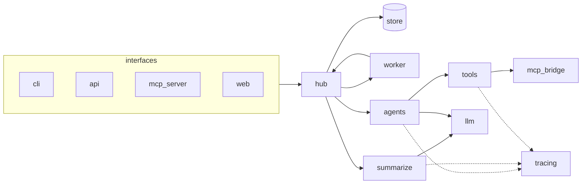
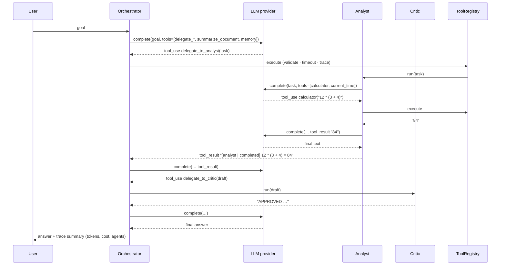
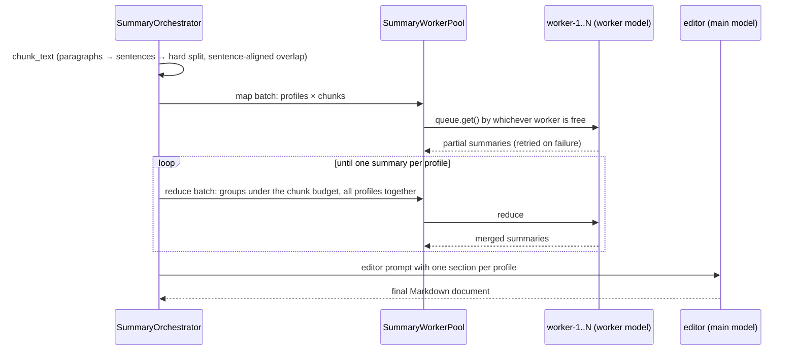
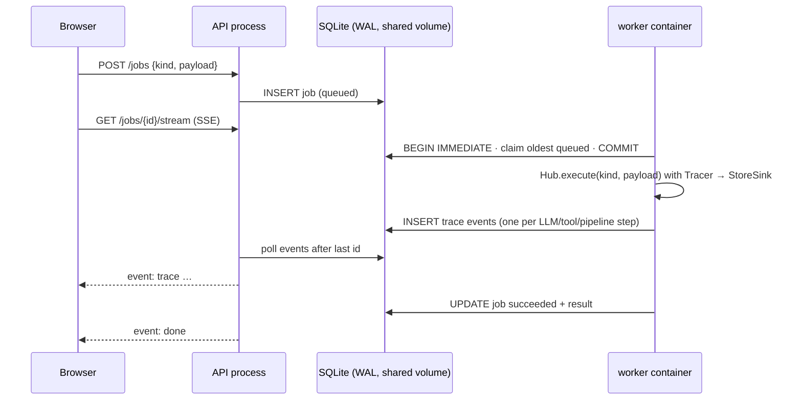

# Architecture

## Layers

1. **Interfaces** (`cli.py`, `api.py`, `mcp_server.py`, `web/`): thin adapters, no business logic.
2. **Hub** (`hub/service.py`): the composition root and the single façade every interface uses.
   It is the only place where concrete providers, stores, tools and MCP bridges are wired.
3. **Execution**: the job store and job workers (`hub/store.py`, `hub/worker.py`).
4. **Pipelines**: the agent team (`agents/`) and the summarization orchestrator (`summarize/`).
5. **Tools** (`tools/`): every capability, local, delegated or remote, behind one `ToolRegistry`.
6. **LLM providers** (`llm/`): vendor SDKs and wire formats isolated behind `LLMProvider`.
7. **Cross-cutting**: `Tracer` (observability), `MemoryStore`, `guardrails`, `pricing`.

Dependencies point inwards: agents and pipelines know the `LLMProvider` and `ToolRegistry`
interfaces, never the Anthropic SDK, `httpx`, SQLite or MCP.

## Request flows

### Agent run

Tool calls in one model turn run concurrently (`asyncio.gather`) and all results go back in one
user message, which keeps parallel tool use working well.

### Multi-worker summary (ensemble)

### Job lifecycle across processes

Because events go through the store, live streaming works the same whether the job ran inside
the API process (`SP_INLINE_WORKERS`) or in another container.

## Key design decisions

**Agents as tools.** The orchestrator has no special delegation protocol: specialists are tools
with a `task` argument. Delegation inherits validation, timeouts, tracing and parallelism.

**Least privilege.** Each specialist receives `tools.subset([...], prefixes=[...])`. The critic has
no tools, the analyst cannot read files, only the researcher sees MCP tools.

**Errors are data.** Unknown tools, bad arguments, timeouts, denials and exceptions become
`tool_result` blocks with `is_error: true`. The model can recover; the process never crashes.

**Canonical, append-only messages.** Messages are lists of text / tool_use / tool_result blocks.
Provider-specific blocks (Claude `thinking`, `fallback`) are carried as `OpaqueBlock` and replayed
byte-for-byte to the same provider, so history is never edited. That keeps prompt caches valid and
keeps the loop compatible with the preserved-thinking checks of current Claude models, which reject
edited history. Adding a vendor means
translating to and from this shape in one class.

**Claude specifics live in one adapter.** `AnthropicProvider` puts a cache breakpoint on the static
prefix (tools + system) and, for agent loops, enables automatic caching of the conversation tail;
one-shot worker calls cache only the prefix (`cache="prefix"`) so they do not pay cache-write
premiums on unique text. Models that support it get `fallbacks="default"` (server-side refusal
fallback). `effort` maps to `output_config`. Sampling parameters are never sent (API version
2026-10-21 rejects them). SDK exceptions are mapped to `LLMError(retryable=…)`.

**Resilience composes at the edge.** `ResilientProvider` (bounded concurrency + jittered
retries) and `FallbackProvider` (vendor chain) wrap any provider. The Anthropic SDK's own retries
handle 429/5xx for Claude, so the wrapper adds only concurrency there. A non-retryable error
such as a 400 is never silently retried on another vendor.

**Model routing.** Map/reduce/refine calls use the worker model (fast, cheap, low effort); the
orchestrator, specialists and the ensemble editor use the main model.

**A pool, not a fan-out.** Summary jobs go through a fixed pool of named workers draining an
`asyncio.Queue`: concurrency is bounded, load balances naturally, retries can land on another
worker, results keep submission order and per-worker stats are visible in traces and the UI.

**Durable, boring queue.** SQLite in WAL mode with `BEGIN IMMEDIATE` claims is enough for a
single host and many worker processes, needs no extra service, and survives restarts; stale
`running` jobs are re-queued on worker start. The store is behind a small class, so Postgres or
Redis can replace it without touching the hub.

**Budgets everywhere.** `max_steps` per agent, per-tool timeouts, output truncation, `max_tokens`
per role, worker pool size, chunk budget. A truncated tool call (`stop_reason == max_tokens`) is
never executed.

**Deterministic testing.** `ScriptedProvider` replays responses and records requests;
`OfflineDemoProvider` understands every role, so the whole system (API, SSE, workers, MCP, CLI,
evals) is tested offline in CI.

## Failure handling

| Failure | Behaviour |
|---|---|
| Rate limit / 5xx / connection error | SDK or `ResilientProvider` retries with backoff; then optional cross-vendor fallback |
| Bad request / auth error | surfaces immediately as `LLMError(retryable=False)`; agent status `error` |
| Model refusal | server-side fallback on supported Claude models; otherwise agent status `refused` |
| Tool exception / timeout / bad args | `tool_result` with `is_error: true`; model decides how to recover |
| Side-effecting tool under `SP_APPROVAL=deny` | denied with an explanation the model relays |
| Summary map job fails | re-queued on the pool (another worker may take it); counted in `failed_jobs` |
| Reduce job fails | degrades to concatenating that group instead of failing the run |
| Every map job for a profile fails | `SummaryError`, job marked `failed` |
| Worker process crashes mid-job | job stays `running`; re-queued by the next worker start after the stale timeout |
| Prompt injection in files / MCP output | fenced as `<untrusted_content>`; known phrases logged as `guardrail` events |
| Path traversal (`../../etc/passwd`) | rejected by the workspace sandbox |

## Production hardening

Done: durable job store and traces, API-key auth, approval policy hook, untrusted-content
fencing, secret redaction in traces, non-root container with healthcheck, eval suite in CI.

Next: OpenTelemetry export, rate limiting per API key, an interactive approval UI, Postgres
store for multi-host deployments, Message Batches for non-urgent summary jobs, token streaming.
